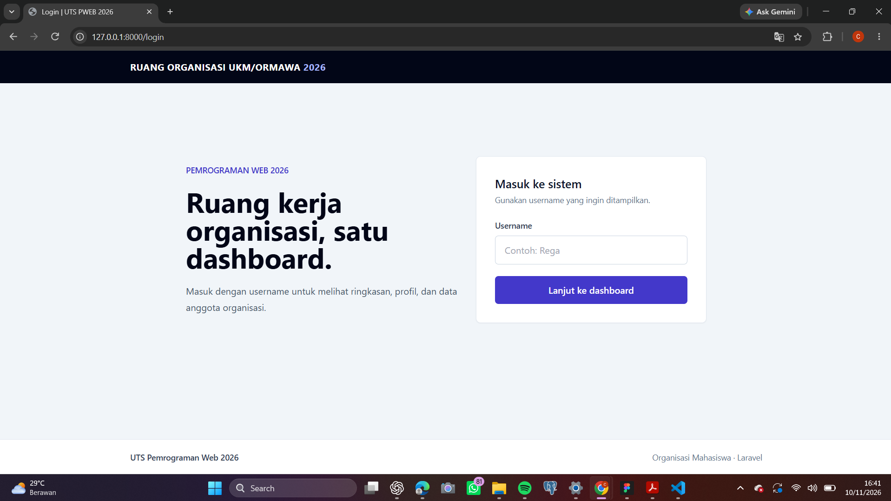
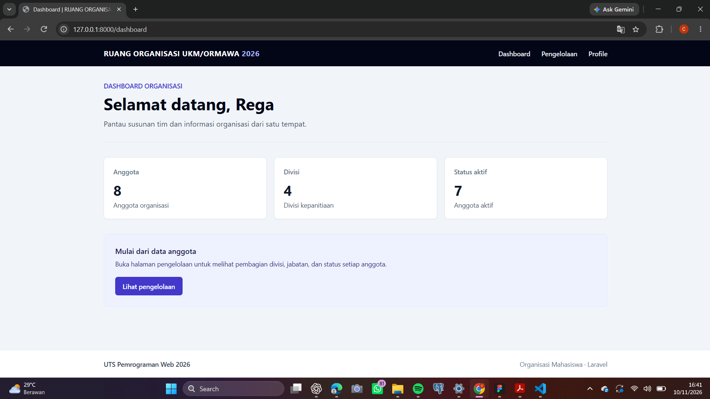
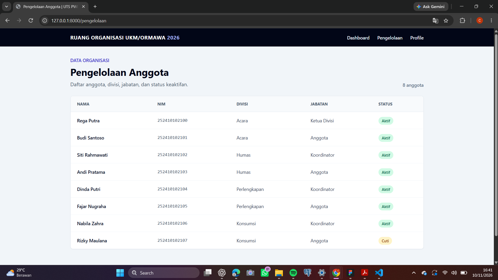
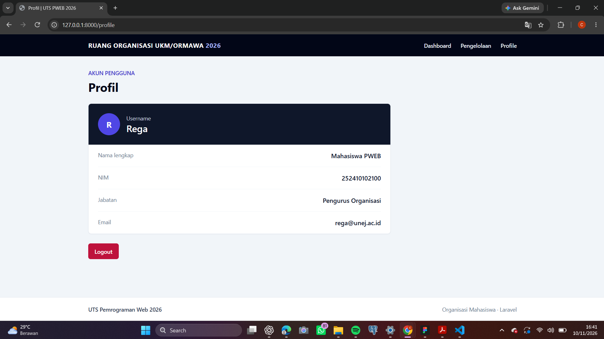

## 📸 Dokumentasi Tampilan Aplikasi

### 1. Halaman Login

Halaman login digunakan sebagai pintu masuk aplikasi ORGANA dengan memasukkan username pengguna.

### 2. Halaman Dashboard

Dashboard merupakan halaman utama yang menampilkan sapaan pengguna dan informasi aplikasi ORGANA.

### 3. Halaman Pengelolaan

Halaman pengelolaan digunakan untuk menampilkan data anggota organisasi secara dinamis menggunakan Array dan Blade Directive `@foreach`.

### 4. Halaman Profile

Halaman profile menampilkan informasi pengguna berdasarkan username yang diteruskan melalui Request Parameter.

